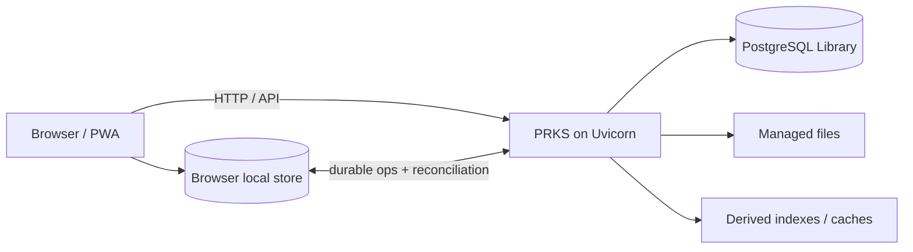

# Architecture

PRKS is a local-first research application with a Python backend, PostgreSQL persistence, managed files on disk, and a vanilla-JavaScript single-page frontend.



The diagram separates canonical server storage from browser-local durable intent and from rebuildable derived indexes.


## Runtime shape

At a high level:

```text
Browser / PWA
  |
  | HTTP / API
  v
PRKS on Uvicorn (backend/web/asgi.py)
  |
  +--> PostgreSQL database (web, worker and migrate processes share it)
  |
  +--> managed files (PDFs, person files)
  |
  +--> derived indexes / caches
```

The normal process entry point is `prks_app.py`. Backend modules under `backend/` own storage, migrations, API/server behavior, synchronization families, PDF processing, backup/restore, indexing, logging, and research-network operations.

The UI is Vue 3 (TypeScript, Vite) under `frontend-app/`: every route page, the sidebar and ribbon, Settings, the command palette and the dialogs. The classic scripts under `frontend/js/` remain the runtime underneath: route and TabContext coordination, durable local-first writes and sync, offline reads, and engines such as the PDF reader and the note editor. `docs/frontend-migration-boundaries.md` lists who owns what. The Python server serves the committed production bundle in `frontend/vue/` with the rest of `frontend/`. Running PRKS does not require Node.

## Backend boundaries

Important backend areas include:

- `backend/server.py` — HTTP adapter lifecycle and method dispatch.
- `backend/api/` — optional domain HTTP controllers extracted from `server.py` (parse/validate, invoke domain, map errors). First family: Saved Views.
- `backend/library.py` — the PostgreSQL Library handle (database and storage) the routes hold; they call `backend/domain/` commands directly.
- `backend/domain/` — Library commands and queries by area (Works, People, Organization, Research, Search, objects, maintenance, identity).
- `backend/db/` and `backend/db/schema/` — the connection pool, transaction helpers, and the schema files the `migrate` runner applies.
- `backend/sync/` — durable operation protocol, envelope and handlers; the per-family rules are `backend/domain/<area>/*_rules.py`.
- `backend/domain/maintenance/` — verified backup (format 2) and restore.
- `backend/jobs/` — the PostgreSQL job queue and worker (text extraction, derived rebuilds, object cleanup, backups).
- `backend/pdf/` — managed PDF files: names, byte replacement, linearization, text extraction, mentions, and annotation adoption and materialization.
- `backend/media/` — derived caches (PDF thumbnails, Person images) and Person portrait fetch.
- `backend/web/` — the HTTP server (ASGI, settings, response surface) and HTTP helpers (`etags.py`, `byte_range.py`).
- `backend/runtime/` — process concerns: settings reference, logging, process roles, readiness, startup timing, performance diagnostics, the runtime dependency check, and the testing reset.
- `backend/storage/` — storage roots, bindings, and file durability primitives.

PostgreSQL is the only Library store (PG-C2). Library writes run inside `library_command` transactions, which check the actor's capability and the Library epoch and take the Library maintenance lock; concurrency between requests and processes is handled by the database (row locks, advisory locks, SERIALIZABLE where a rule needs it), not by a process-local lock.

## Frontend boundaries

Important frontend areas include:

- `frontend-app/` — Vue 3 + TypeScript source. Production output is the committed `frontend/vue/` bundle. It renders the route pages (`src/features/`, presented through `src/route-surface/`), the app chrome, Settings, the command palette and the dialogs (`src/modal/`). TanStack Query holds disposable server snapshots only. The workspace shell renders a read-only projection; it does not own tabs, focus, or split state.
- `frontend/js/app.js` and `navigation.js` — route resolution and navigation: the coordinator that hands each route to its Vue page.
- `components/` — per-route classic runtime: data loading, durable writes and the bridges each Vue page calls.
- `tab-context.js` and `workspace-*.js` — in-app tabs, split view, pane layout, and persistence.
- `local-store.js`, `sync-runtime.js`, and domain `*-state.js` modules — durable local-first intent and reconciliation.
- `offline-store.js` / `offline-runtime.js` — disposable offline read projections and availability behavior.
- `request-coordinator.js` — short-lived request coordination/cache for normal online traffic; this is not durable offline storage.
- `pdf-*.js` and `components/works-pdf.js` — PDF viewer lifecycle and annotation integration.

## Canonical data vs derived data

PRKS distinguishes data that must be preserved from data that can be rebuilt.

Canonical examples:

- the PostgreSQL Library database;
- managed PDFs and managed person files;
- durable operation state required for local-first reconciliation.

Derived examples include thumbnail caches, PDF text-search indexes, and research-reference indexes. Derived data can be discarded and rebuilt without changing research intent.

That distinction is central to backup/restore and to offline synchronization.

## Local-first architecture

PRKS uses two different mechanisms that must not be conflated:

1. **Disposable read projections/caches** make selected pages useful when the server cannot be reached.
2. **Durable local operations** store user intent before PRKS reports the change as saved, then reconcile that intent with the canonical server state.

A short-lived HTTP request cache is a third mechanism and is not a substitute for either one.

The implementation details and current operation families are documented in:

- [docs/local-first-sync.md](https://github.com/Fooftilly/PRKS/blob/master/docs/local-first-sync.md)
- [docs/local-first-rollout-status.md](https://github.com/Fooftilly/PRKS/blob/master/docs/local-first-rollout-status.md)

## Workspace architecture

Each visible PRKS page runs inside a TabContext. Main and Secondary panes have separate route state, DOM roots, async generations, and live resources. This prevents split-view pages from accidentally sharing document-scoped state. Logical workspace structure (tabs, Main, focus, and the Secondary tree) is one typed model. The workspace coordinator applies that model and owns effects, dirty checks, persistence, history, and TabContext lifetime. The Vue workspace shell only renders the published snapshot and sends intents. TabContext and the route-surface own feature content inside a stable host keyed by tab id. TabContext remains the per-pane runtime and is not serialized with the workspace model.

See [Workspace Tabs and Split View](Workspace-Tabs-and-Split-View.md).

## Design authority

For UI structure, interaction rules, responsive behavior, and visual-system constraints, use [DESIGN.md](https://github.com/Fooftilly/PRKS/blob/master/DESIGN.md). The wiki explains architecture; it does not replace that design specification.
