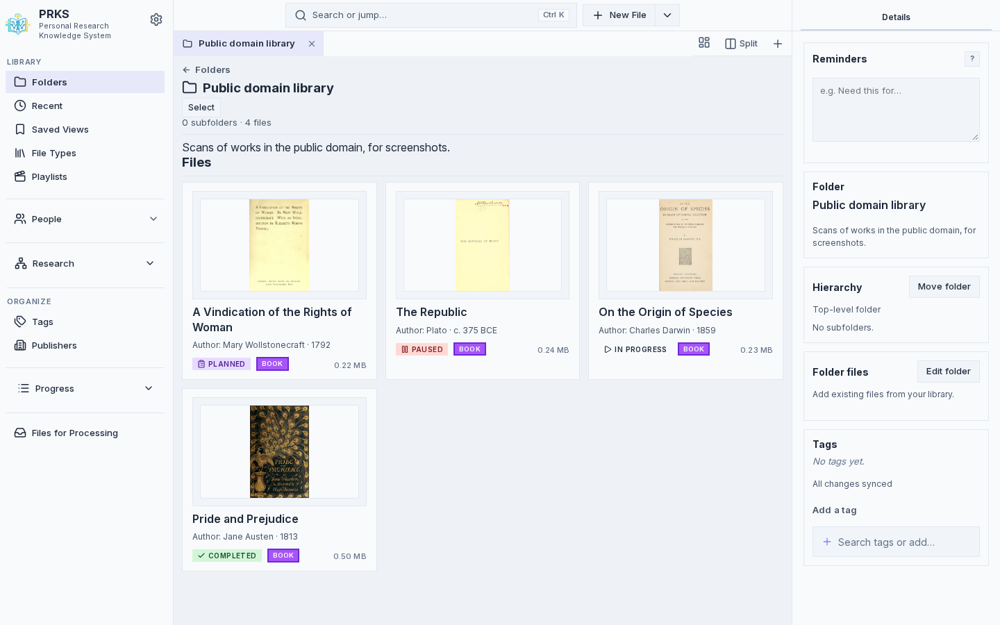

# Getting Started

PRKS is designed to run locally. It needs Python and a PostgreSQL 18 server; Docker Compose can run both for you.




## Requirements

PRKS currently requires Python 3.12 or newer, the exact Python package versions pinned in `requirements.txt`, and a PostgreSQL 18 database (`PRKS_DATABASE_URL`). The application validates the Python environment before it touches the database, the storage root, or the network.

Use a project-local virtual environment. On distributions that enforce PEP 668, do not bypass the package manager with `sudo pip` or `--break-system-packages`.

```bash
python3 -m venv .venv
./.venv/bin/python -m pip install -r requirements.txt
export PRKS_DATABASE_URL='postgresql://prks:<password>@127.0.0.1:5432/prks'
./.venv/bin/python prks_app.py
```

On a first run the server applies the schema and waits for setup: create the owner account and the Library with [admin bootstrap](https://github.com/Fooftilly/PRKS/blob/master/docs/admin-bootstrap.md) (the README's "Quick start" has the two commands). Then open `http://127.0.0.1:8080` and sign in.

A different loopback port can be selected with `--port`. To make PRKS reachable on another interface, pass an explicit host such as `--host 0.0.0.0`. Every account signs in with its password, but do not expose PRKS to an untrusted network without an HTTPS reverse proxy; see [Security and Operations](Security-and-Operations.md).

## Testing mode

```bash
scripts/dev-postgres            # once: a local PostgreSQL 18 for testing, in Docker
unset PRKS_DATABASE_URL         # if you exported your Library's URL above
./.venv/bin/python prks_app.py --testing
```

Testing mode listens on `127.0.0.1:8070` by default and uses the `scripts/dev-postgres` database unless `PRKS_DATABASE_URL` (or `PRKS_DATABASE_URL_FILE`) is set; it refuses a database that is not marked for testing, so a shell that still exports your regular Library's URL will not start it. Unset that variable first, or export the testing URL that `scripts/dev-postgres` prints. On a fresh testing database every request acts as the owner (loopback only). Open `http://127.0.0.1:8070` in a browser. When `PRKS_STORAGE` is not set, it isolates data under `data_testing/`. It contains safety checks intended to prevent tests from binding to the normal repository `data/` tree.

Use testing mode for browser automation, demo data, screenshots, and destructive experiments.

## Docker

Build with the repository helper:

```bash
./docker-build.sh
```

Then start the Compose deployment:

```bash
docker compose up -d
```

Compose publishes PRKS on host loopback by default and mounts `./data` into the container as `/data`. The container binds internally to `0.0.0.0:8080`; that does not by itself expose the host on every network interface.

For the exact current Docker, UID/GID, storage, and publish-host behavior, use the [README](https://github.com/Fooftilly/PRKS/blob/master/README.md).

## Storage location

Set `PRKS_STORAGE` to choose the persistent-data root. When it is unset in a normal run, PRKS uses the repository's `data/` directory.

Canonical data is the PostgreSQL Library database plus the managed files in the data root. Thumbnail/search/research indexes are derived and may be rebuilt. See [Storage, Backup, and Restore](Storage-Backup-and-Restore.md).

## Next steps

After the server is running:

1. Create or import Works and organize them into Folders.
2. Add People, Roles, Tags, and Playlists as needed.
3. Use the Work view for PDFs, notes, metadata, annotations, and related research.
4. Use the command palette (Ctrl+K, or Cmd+K on macOS) for fast navigation and creation.
5. Read [Workspace Tabs and Split View](Workspace-Tabs-and-Split-View.md) if you want several research surfaces open together.
6. Read [Offline and Sync](Offline-and-Sync.md) before relying on offline editing; coverage evolves and the rollout-status document is the definitive current score.
